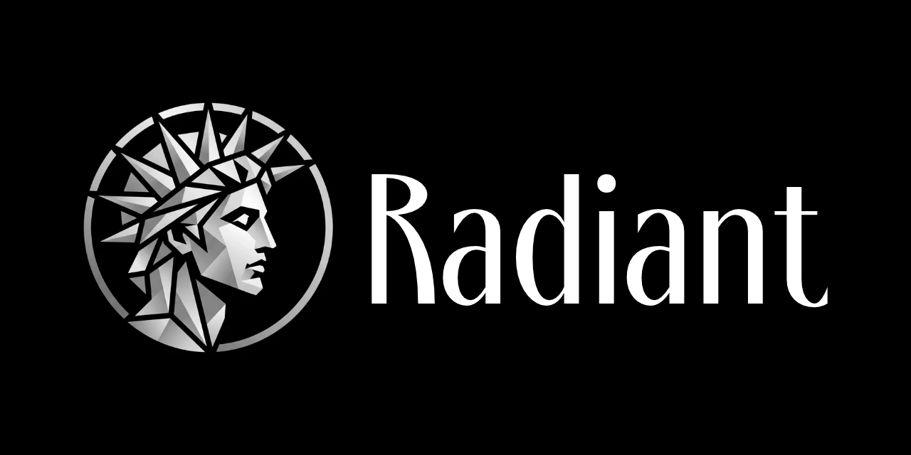

  

<h1 align="center">Radiant for Android</h1>

  A simple, private music player for your local audio files. 
  No ads. No accounts. Your music stays on your device.

  <a href="../../releases/latest"><b>Download the latest APK</b></a> ·
  <a href="README_pc.md">PC version</a>

  <a href="README.md">English</a> ·
  <a href="README.cs.md">Čeština</a> ·
  <a href="README.de.md">Deutsch</a> ·
  <a href="README.es.md">Español</a> ·
  <a href="README.fr.md">Français</a> ·
  <a href="README.ja.md">日本語</a> ·
  <a href="README.pl.md">Polski</a> ·
  <a href="README.ru.md">Русский</a> ·
  <a href="README.zh.md">中文</a>

  
  

---

## Why Radiant

Radiant plays music from **one folder you choose**. It scans that folder and its subfolders, without adding ringtones, voice messages or other sounds from elsewhere on your phone. Android's Storage Access Framework keeps access limited to the folder you selected.

There are no ads or accounts. Playback works offline; an internet connection is only needed for optional Dropbox downloads or the one-time AI model download.

## Features

- **Your music library:** browse Tracks, Albums and Playlists, with search and sorting. Create and manage playlists; *Liked tracks* is always at the top. Four fixed queues are available for quick listening lists.
- **Full playback controls:** background playback, media notification, lock-screen and headset controls, shuffle, repeat, seeking and playback speed from 3× slower to 3× faster without changing pitch.
- **Lyrics:** read lyrics from track tags or nearby `.lrc` / `.txt` files. Synchronized lyrics follow the song, and tapping a line jumps to that point.
- **Sound settings:** 12-band equalizer with 10 presets, bass and treble boost, volume normalization, mono/stereo and a subsonic filter. Equalizer settings can be shared across tracks or saved per track.
- **AI stem separation:** split a track into vocals, drums, bass and other, then mix the parts you want into a WAV file. Processing runs on your device. Download or import the models once; after that, stem separation works offline.
- **Optional Dropbox download:** copy music from a Dropbox folder you choose into your music folder. This is one-way: Radiant does not upload, change or delete anything in Dropbox.
- **Privacy and customization:** optional app lock, light/dark/true-black themes, dynamic colors on Android 12+, and 10 interface languages.
- **Formats:** MP3, FLAC, OGG/Opus, M4A/AAC, ALAC, WAV and other formats supported by Android.

## Download and install

Radiant requires **Android 8.0 (API 26) or newer**.

1. Open the **[latest release](../../releases/latest)** on your phone and download the APK.
2. Open the downloaded file and allow installation from this source if Android asks.
3. Launch Radiant and choose the folder that contains your music.

New versions can be installed over the existing app, so your playlists and settings are kept.

## Get started

1. Tap **Choose folder** and select your music folder.
2. Browse **Playlists**, **Albums** or **Tracks** and tap a song to play it.
3. To create a playlist, open the **⋮** menu next to a track and choose **Add to playlist**.

To change the app language, open **Settings → App language**. Choose a language or leave it on **System** to follow your phone's language.

## License

Radiant is licensed under the [PolyForm Noncommercial License 1.0.0](LICENSE.md). It is free for personal and other noncommercial use; commercial use requires a separate agreement.
