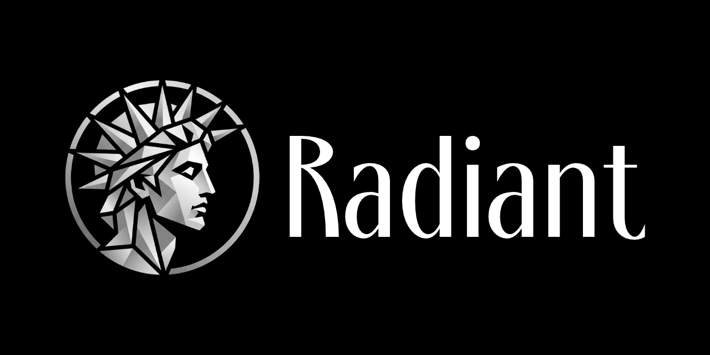

  

<h1 align="center">Radiant for Android</h1>

  Prosty, prywatny odtwarzacz muzyki dla Twoich lokalnych plików audio. 
  Bez reklam. Bez kont. Twoja muzyka zostaje na Twoim urządzeniu.

  <a href="../../releases/latest"><b>Pobierz najnowszy APK</b></a> ·
  <a href="https://github.com/john3sobieski/radiant-audio-player-pc">Wersja na PC</a>

  <a href="README.md">English</a> ·
  <a href="README.cs.md">Čeština</a> ·
  <a href="README.de.md">Deutsch</a> ·
  <a href="README.es.md">Español</a> ·
  <a href="README.fr.md">Français</a> ·
  <a href="README.ja.md">日本語</a> ·
  <a href="README.pl.md">Polski</a> ·
  <a href="README.ru.md">Русский</a> ·
  <a href="README.zh.md">中文</a>

  
  

---

## Dlaczego Radiant

Radiant odtwarza muzykę z **jednego wybranego przez Ciebie folderu**. Skanuje ten folder i jego podfoldery, nie dodając dzwonków, wiadomości głosowych ani innych dźwięków z innych miejsc w telefonie. Storage Access Framework systemu Android ogranicza dostęp do wybranego folderu.

Nie ma reklam ani kont. Odtwarzanie działa offline; połączenie z internetem jest potrzebne tylko do opcjonalnego pobierania z Dropboxa lub jednorazowego pobrania modeli AI.

## Funkcje

- **Twoja biblioteka muzyczna:** przeglądaj Utwory, Albumy i Playlisty z wyszukiwaniem i sortowaniem. Twórz playlisty i zarządzaj nimi; *Polubione utwory* są zawsze na górze. Cztery stałe kolejki służą do szybkich list odsłuchowych.
- **Pełna kontrola odtwarzania:** odtwarzanie w tle, powiadomienie multimedialne, sterowanie z ekranu blokady i słuchawek, losowa kolejność, powtarzanie, przewijanie oraz prędkość odtwarzania od 3× wolniej do 3× szybciej bez zmiany wysokości dźwięku.
- **Teksty piosenek:** odczytuj teksty z tagów utworu lub z pobliskich plików `.lrc` / `.txt`. Zsynchronizowane teksty podążają za piosenką, a dotknięcie wiersza przenosi do tego miejsca.
- **Ustawienia dźwięku:** 12-pasmowy korektor z 10 presetami, podbicie basów i wysokich tonów, normalizacja głośności, mono/stereo oraz filtr subsoniczny. Ustawienia korektora mogą być wspólne dla wszystkich utworów lub zapisywane dla każdego utworu osobno.
- **Separacja stemów przez AI:** podziel utwór na wokal, perkusję, bas i resztę, a następnie zmiksuj wybrane części do pliku WAV. Przetwarzanie odbywa się na Twoim urządzeniu. Modele wystarczy raz pobrać lub zaimportować; potem separacja stemów działa offline.
- **Opcjonalne pobieranie z Dropboxa:** skopiuj muzykę z wybranego folderu Dropboxa do swojego folderu z muzyką. To działa tylko w jedną stronę: Radiant niczego nie wysyła do Dropboxa, nie zmienia ani nie usuwa.
- **Prywatność i personalizacja:** opcjonalna blokada aplikacji, jasny/ciemny/czarny motyw, kolory dynamiczne na Androidzie 12+ i 10 języków interfejsu.
- **Formaty:** MP3, FLAC, OGG/Opus, M4A/AAC, ALAC, WAV i inne formaty obsługiwane przez Androida.

## Pobieranie i instalacja

Radiant wymaga **Androida 8.0 (API 26) lub nowszego**.

1. Otwórz **[najnowsze wydanie](../../releases/latest)** na telefonie i pobierz plik APK.
2. Otwórz pobrany plik i zezwól na instalację z tego źródła, jeśli Android o to zapyta.
3. Uruchom Radiant i wybierz folder z muzyką.

Nowe wersje można instalować na istniejącej aplikacji, więc Twoje playlisty i ustawienia zostaną zachowane.

## Pierwsze kroki

1. Dotknij **Wybierz folder** i wskaż folder z muzyką.
2. Przeglądaj **Playlisty**, **Albumy** lub **Utwory** i dotknij utworu, aby go odtworzyć.
3. Aby utworzyć playlistę, otwórz menu **⋮** obok utworu i wybierz **Dodaj do playlisty**.

Aby zmienić język aplikacji, otwórz **Ustawienia → Język aplikacji**. Wybierz język lub zostaw **System**, aby aplikacja korzystała z języka telefonu.

## Licencja

Radiant jest udostępniany na licencji [PolyForm Noncommercial License 1.0.0](LICENSE.md). Jest bezpłatny do użytku osobistego i innego niekomercyjnego; użytek komercyjny wymaga osobnej umowy.
